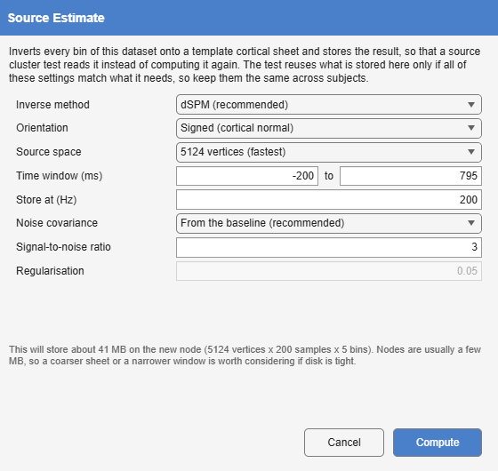
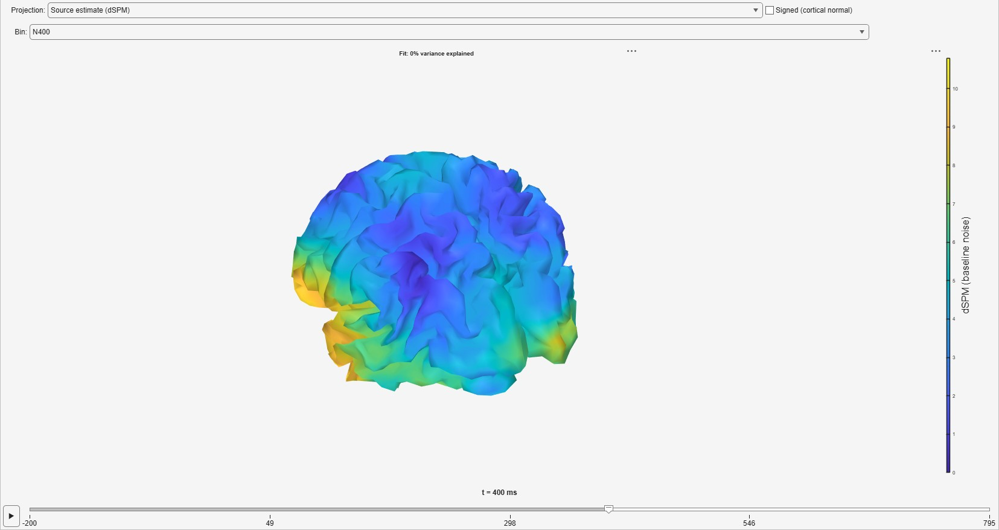

*Tools > 4. Frequency and Component Analysis > Source Estimate · averaged →
averaged, with a stored source estimate · `SourceEstimate`*

Inverts every bin of an averaged dataset onto a template cortical surface
and stores the result on a node, so that a source cluster test
([The same test in source space](https://markspan.github.io/Alakazam/#sec-source-cluster)) and the 3D brain read it instead of computing it again.
The inverse methods and their limits are described in
[Source estimation](https://markspan.github.io/Alakazam/#sec-source-estimation).

{#fig-sourceestimate-dialog}

| Option | Default | Meaning |
|--------------|------------------------|-------------------------------------------------------|
| **Inverse method** | dSPM | **dSPM** [@dale2000] or **sLORETA** [@pascualmarqui2002]. |
| **Orientation** | Signed (cortical normal) | The dipole component along the cortical normal, keeping its sign, or the **Magnitude** of a free orientation. |
| **Source space** | 20 484 vertices | The template cortical mesh: 20 484, 8 196 or 5 124 vertices. |
| **Time window** | the whole epoch | The samples stored. |
| **Store at** | 200 Hz | The rate the estimate is stored at. |
| **Noise covariance** | From the baseline | What dSPM is normalised by: the baseline covariance Average stored, or **White noise (identity)** ([The noise covariance](https://markspan.github.io/Alakazam/#sec-noise-covariance)). Only white noise is offered when the dataset carries no baseline covariance. |
| **Signal-to-noise ratio** | 3 | With the baseline covariance, sets the regularisation, λ = 1/SNR². |
| **Regularisation** | 0.05 | The Tikhonov regularisation with white noise, and for sLORETA. |

: Source Estimate's options. {#tbl-sourceestimate}

A stored estimate is reused only when every one of these settings, the
montage and the data themselves match what the later analysis needs, so they
should be the same for every subject. The dialog shows the space the node
will take, which for a fine mesh and a long window is much larger than a
typical node.

{#fig-sourceestimate-result}
